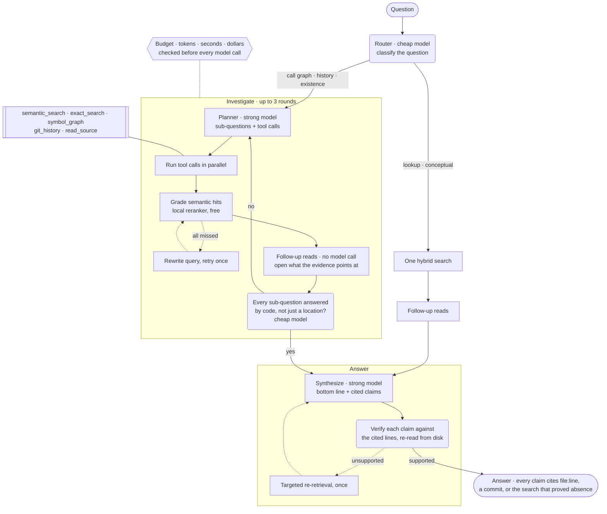
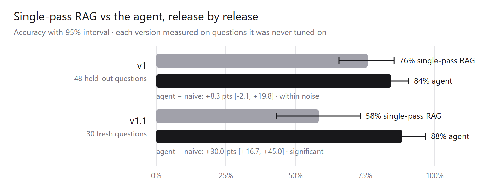
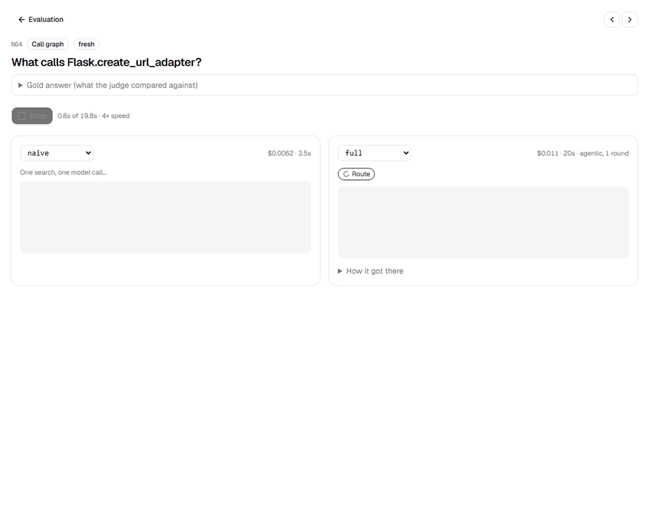
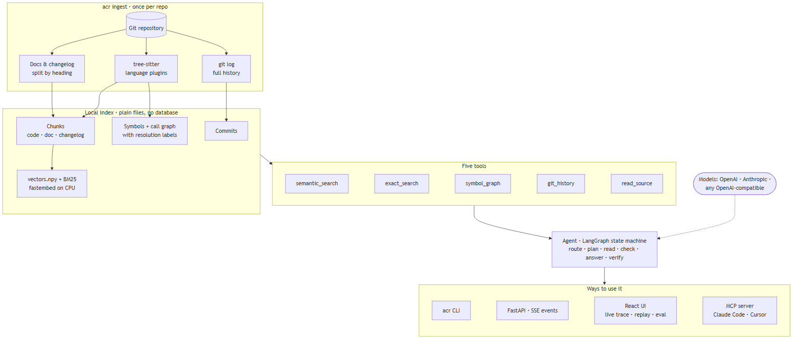
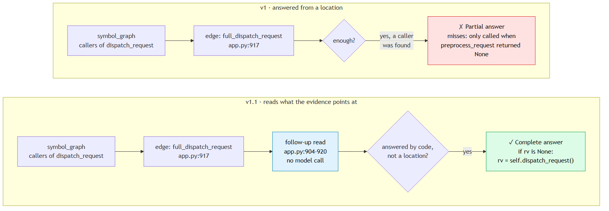
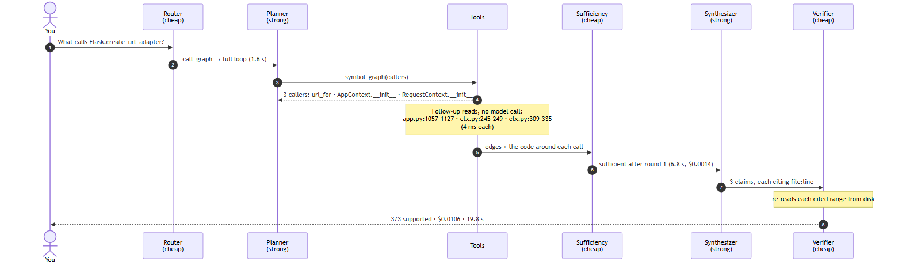
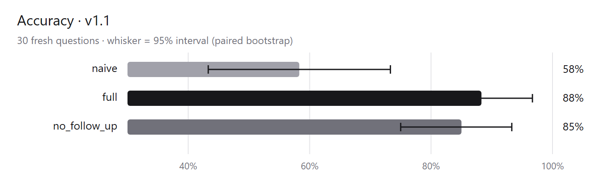
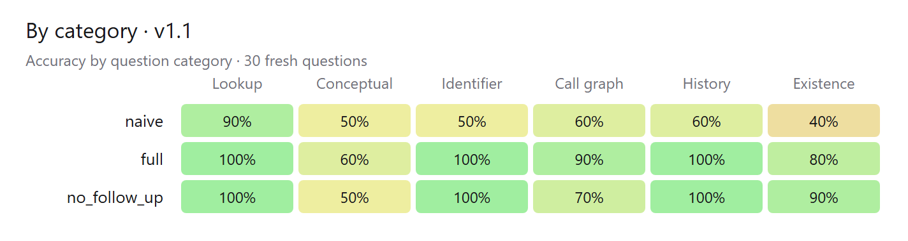
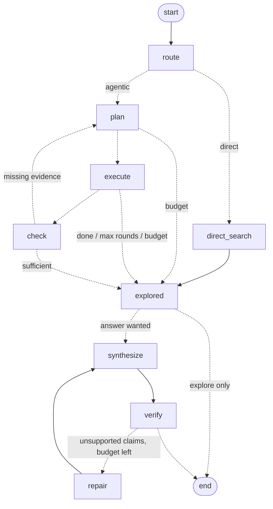

# agentic-code-rag

Ask questions about a Python codebase and get answers you can check. An agent decides how to search — by meaning, exact names, the call graph, or git history — throws out weak evidence, tries again when it misses, and cites `file:line` for every claim. And it stops when it hits the budget you set.

> **Status:** v1.0 release candidate. On 30 questions it was never tuned on, the agent scored 88% against 58% for single-pass RAG at about 2x the cost ([results and caveats](#evaluation)).

## Why

Single-pass RAG retrieves once and hopes. That works for "what does `X` do?" and falls apart on "who ends up calling `X` when a request fails, and why was that changed in 2.3?". This project puts an agent in the loop and **measures** what each piece of that loop actually buys — accuracy, cost and latency — against a plain RAG baseline.

## How it works



**How to read it:** the router only *classifies* the question; code maps the category to a path,
so "does X exist?" can never be answered from a single search. Exact search, the call graph,
history and source reads return precise facts; only fuzzy semantic hits are graded. After each
round the agent reads the code its evidence points at (the function around a grep hit, the caller
around a call-graph edge) before asking whether it has enough, because a location isn't an answer.
Claims that still fail verification after one repair are removed from the answer and listed,
never kept quietly.
The exact LangGraph state machine is in [The agent graph](#the-agent-graph) below.

## In pictures

| | |
|---|---|
|  |  |
| **Release by release.** Each version measured on questions it was never tuned on. | **Side by side.** Single-pass RAG answers in 3.5 s and misses a caller; the agent reads the code around each call and gets all three, every claim verified. |

**Architecture:** one local index, five tools, one agent, four ways to use it.



**What v1.1 changed:** v1 lost points by answering from a *location*. v1.1 reads what the evidence points at.



**One real run**, from the fresh eval set: one planned tool call, three follow-up reads, one round, $0.0106.



**The numbers** (v1.1 on 30 fresh questions; [all charts](docs/images/)):

| | |
|---|---|
|  |  |

All of these are generated: diagrams from `docs/diagrams/*.mmd`, charts from the saved eval
results (`acr eval charts`), and the GIF from a recorded replay. `docs/render-images.ps1`
rebuilds the diagrams and charts.

## Quick start (developers)

Requires [uv](https://docs.astral.sh/uv/) and git.

```bash
cd backend
uv sync                      # creates .venv and installs everything
uv run acr corpus fetch flask  # clones Flask 3.1.3 (the demo corpus) into data/corpora
uv run acr ingest flask      # chunks + symbol graph + history, then embeddings -> data/indexes/flask
uv run poe check             # lint, format check, type check, tests
```

`acr ingest` also takes a path to any local git repo: `uv run acr ingest D:\path\to\repo`.
Embedding runs locally on CPU (FastEmbed, `bge-small-en-v1.5`, ~67 MB download once). For Flask's
2,176 chunks that took 22 minutes on a laptop CPU (one-time per index); `--no-embed` skips it.

## The tools

Every tool works from the CLI today, and the agent will call the same functions:

```bash
uv run acr search flask "how are teardown functions run after a request"   # semantic_search (hybrid)
uv run acr grep   flask SESSION_COOKIE_SAMESITE                             # exact_search
uv run acr symbol flask full_dispatch_request --rel callees                 # symbol_graph
uv run acr history flask Flask.make_response                                # git_history (follows the lines)
uv run acr read   flask src/flask/app.py --start 900 --end 940              # read_source
uv run acr ask    flask "who ends up calling handle_user_exception?"        # the agent: verified, cited answer
uv run acr ask    flask "who ends up calling handle_user_exception?" --trace  # ...plus how it investigated
uv run acr ask    flask "what does preprocess_request do?" --naive          # single-pass RAG baseline
uv run acr explore flask "does Flask have built-in rate limiting?"          # the investigation only
```

`acr ask` writes the answer as a bottom line plus separate claims, each citing `file:line`, a
commit, or the search that proved something absent. Every claim is then checked against the
cited lines **re-read from disk**; unsupported claims trigger one targeted re-retrieval, and
anything that still fails is removed and listed under "Removed" rather than kept quietly.

`acr explore` shows just the investigation: the router's decision, each planning round's
sub-questions and tool calls, what every call returned, how semantic hits were graded, any
query rewrites, the sufficiency check, and why the loop stopped.

How the loop keeps cost down:

- **Grading:** a local cross-encoder (`ms-marco-MiniLM-L-6-v2`) scores every semantic hit;
  clear misses are dropped for free. (v1 sent the borderline band to the cheap model; the eval
  showed it bought nothing, so it's now an ablation, `llm_grading`.) Exact search, the call
  graph, history and source reads are precise, so they aren't graded.
- **Follow-up reads:** up to three `read_source` calls per round for what the evidence points
  at, decided by code, not a model call.
- **Rewrite:** if every hit of a search is dropped, the cheap model rewrites the query once.
- **Sufficiency:** after each round the cheap model checks whether every sub-question is
  answered; if so the loop stops before paying for another planner call.
- **Budget:** per-question limits on tokens, seconds and dollars (`ACR_BUDGET_MAX_TOKENS`,
  `ACR_BUDGET_MAX_SECONDS`, `ACR_BUDGET_MAX_COST_USD`), checked before every model call.

## The agent graph

The agent is an explicit [LangGraph](https://github.com/langchain-ai/langgraph) state machine
(`uv run acr graph` prints it). Dotted edges are decisions made at run time:



Every node emits a typed event (`agent/events.py`): routed, planned, tool started/finished,
graded, checked, synthesized, verified, finished. The CLI (`acr ask --stream`), the API and
the UI all consume that one stream.

## Running the API

```bash
uv run acr serve                 # http://127.0.0.1:8000 — models load once at startup
```

| Endpoint | What it does |
|---|---|
| `POST /api/ask` `{"question": "..."}` | Streams the run as server-sent events; the last event is `finished` with the full answer (or `failed`) |
| `GET /api/source?path=&start=&end=` | Numbered lines — what a citation points at |
| `GET /api/index` | Which repository, ref and provider the server answers about |
| `GET /api/runs`, `GET /api/runs/{id}` | Recent questions, and one saved run with every event — what a share link replays |
| `GET /api/samples` | Example questions for the UI |
| `GET /api/eval`, `GET /api/eval/{run}` | Eval runs, and one run's dashboard (summaries, intervals, every grade) |
| `GET /api/eval/{run}/{config}/{question}` | One saved eval answer with its full trace |
| `GET /healthz`, `GET /readyz` | Liveness, and readiness once models are loaded |

`ACR_DEMO_MODE=true` turns on public-demo limits: questions per IP per hour, a daily cap,
and fewer planning rounds.

## The web UI

```bash
cd web && pnpm install && pnpm build     # once; acr serve then serves it at http://127.0.0.1:8000
pnpm dev                                 # or: hot reload on :5173, proxying /api to :8000
```

- **Ask** streams the run live: the pipeline lights up stage by stage, each planning round
  shows its sub-questions and tool calls, and a meter tracks dollars, tokens and seconds
  against the budget. Switch to *Naive RAG* to see the single-search baseline answer the same question.
- **Every citation opens the evidence**: the cited lines highlighted in the file with
  context around them, the commit diff, or the search result, with a link to GitHub.
- **Runs are saved** (`data/runs/`) and get a share link; *Replay* plays the run back at 4×
  speed exactly as it happened.
- **Evaluation** shows every eval run: held-out accuracy first, each configuration with its
  bootstrap 95% interval, accuracy against cost, a paired comparison that says whether a
  difference is real or noise, accuracy by question category, and a grid of every question ×
  configuration. Open any question to replay two configurations side by side on one clock.
- Dark mode, a layout that works on a phone, and it installs as an app (PWA) from the browser.

The TypeScript types are generated from the backend's Pydantic models (`pnpm gen:types`,
via `acr schema`), so the event stream can't drift between the two.

## Evaluation

`eval/questions.jsonl` holds 109 questions about Flask with gold answers, key facts and gold
evidence, in three splits:

- **dev** (31): used while building the agent
- **held-out** (48): written after v1 was built; v1's headline, and what v1.1 was diagnosed on
- **fresh** (30): written after v1.1 was built and never used to tune it; the current headline

```bash
uv run acr eval check                              # validate the gold evidence against the repo (free)
uv run acr eval run v1 --configs all               # dry run: prints the estimated cost
uv run acr eval run v1 --configs all --yes         # 8 configurations x 79 questions, resumable
uv run acr eval report v1                          # rewrite results.md and dashboard.json (free)
```

Each answer is graded by a judge model against the gold answer (correct, partial, incorrect,
or abstained), and the ablations switch off one part of the agent at a time. v1 results:
[`eval/results/v1/results.md`](eval/results/v1/results.md), or the **Evaluation** page in the UI.
v1 on the held-out set: the agent scored 84% against 76% for single-pass RAG at 1.5x the
cost, a gap that was *not* statistically significant at 48 questions. Every loss was a
partial answer: the agent stopped at *where* something is (a call-graph edge, a grep line,
a search hit cut off at 40 lines) instead of reading *what* the code there does.

v1.1 reads what its evidence points at before deciding it has enough, tells the sufficiency
check that a location isn't an answer, and asks the synthesizer for conditions and edge cases.
On the fresh set ([`eval/results/v11/results.md`](eval/results/v11/results.md)):

| | Accuracy (95% interval) | vs naive | $/question | p50 |
|---|---|---|---|---|
| Single-pass RAG | 58% [43, 73] | | $0.0064 | 4.0s |
| Agent v1.1 | 88% [78, 97] | +30 pts [+17, +45], 11 wins / 0 losses | $0.0137 | 20.4s |
| v1.1 without follow-up reads | 85% [75, 93] | +27 pts [+13, +42] | $0.0108 | 21.9s |

Caveats: the fresh questions were written knowing v1's failure mode, so they ask for more
detail than the held-out set did (naive drops from 76% to 58%). The follow-up reads alone
add 3 points (within noise) for 27% more cost; their wins are the call-graph questions they
were designed for.

## Use it from Claude Code, Cursor or any MCP client

`acr mcp` serves the five tools plus `ask` over the [Model Context Protocol](https://modelcontextprotocol.io).
The five tools only read the local index (free, marked read-only); `ask` runs the full agent
and calls your model provider.

**Claude Code**

```bash
claude mcp add agentic-code-rag -- uv --directory /path/to/agentic-code-rag/backend run acr mcp
```

**Cursor** (`.cursor/mcp.json`) or **Claude Desktop** (`claude_desktop_config.json`)

```json
{
  "mcpServers": {
    "agentic-code-rag": {
      "command": "uv",
      "args": ["--directory", "/path/to/agentic-code-rag/backend", "run", "acr", "mcp"]
    }
  }
}
```

Then ask your assistant things like *"use agentic-code-rag to find who calls
handle_user_exception"*. Serve a different index with `acr mcp --index myrepo`, or over HTTP
with `acr mcp --transport http` (`http://127.0.0.1:8001/mcp`).

The API server, the MCP server and the CLI can all run at once against the same index:
vectors are plain files (`vectors.npy`), not a database holding a lock.

## Model providers

Copy `.env.example` to `.env` (repo root). The default provider is **OpenAI** (`OPENAI_API_KEY`);
set `ACR_PROVIDER=anthropic` and `ANTHROPIC_API_KEY` to use Claude instead. Any Chat Completions
server also works through the OpenAI provider — for example a free local model with
[Ollama](https://ollama.com): `ACR_OPENAI_BASE_URL=http://localhost:11434/v1`.

| Provider | Cheap roles (router, grader, rewriter) | Heavy roles (planner, synthesizer, verifier) |
|---|---|---|
| OpenAI (default) | `gpt-6-luna` | `gpt-6.1-sol` |
| Anthropic | `claude-haiku-5-5` | `claude-sonnet-5-5` |

`acr ask` prints tokens and cost for every question: about $0.006 for a naive answer and around a cent or two for a verified agent answer with the default models.

## What ingestion produces

Plain JSONL files you can open and grep:

| File | Contents |
|---|---|
| `chunks.jsonl` | Functions/methods (long ones split with overlap), class and module outlines with bodies collapsed, doc sections with heading breadcrumbs, one changelog entry per version |
| `symbols.jsonl` | Modules, classes, functions, methods, module/class-level variables — with signature, first docstring paragraph, decorators and exact line spans |
| `edges.jsonl` | `contains`, `calls`, `inherits`, `decorated_by`, `imports` — each labelled with **how** it was resolved |
| `commits.jsonl` | Full history: subject, body, author, date and touched files |
| `manifest.json` | Counts, including the resolution breakdown below |

Static analysis of a dynamic language can't see everything, so every edge says how sure it is:

| Resolution | Meaning |
|---|---|
| `exact` | Followed imports, re-exports, enclosing scopes, or `self`/`super()` through the class hierarchy |
| `receiver` | The object is known (e.g. the `request_started` signal), the method called on it is not |
| `heuristic` | The only symbol in the repo with that name |
| `ambiguous` | A few same-named candidates — one edge each |
| `external` | Lives outside the repo (stdlib, Werkzeug, …) |
| `unresolved` | Nothing static analysis can see (attributes of local variables, dynamic dispatch) |

Language support is a plugin (`languages/base.py`); Python is the only one in v1.

## Roadmap

| Release | Scope |
|---|---|
| v1.0 | Python codebases · agent loop · MCP server · React trace UI · ablation eval · Docker Compose · public demo |
| v1.1 | Helm chart · AWS (ECS Fargate + Bedrock) |
| v2.0 | Go, C#, TypeScript, Angular |
| v2.1 | Terraform, Kubernetes, GitHub Actions, Bash — and the links between them |

## Prior work

The loop builds on ideas from [Self-RAG](https://arxiv.org/abs/2310.11511), [Corrective RAG](https://arxiv.org/abs/2401.15884) and [Adaptive-RAG](https://arxiv.org/abs/2403.14403).

## License

MIT — see [LICENSE](LICENSE). Corpus licenses: [THIRD_PARTY_NOTICES.md](THIRD_PARTY_NOTICES.md).
